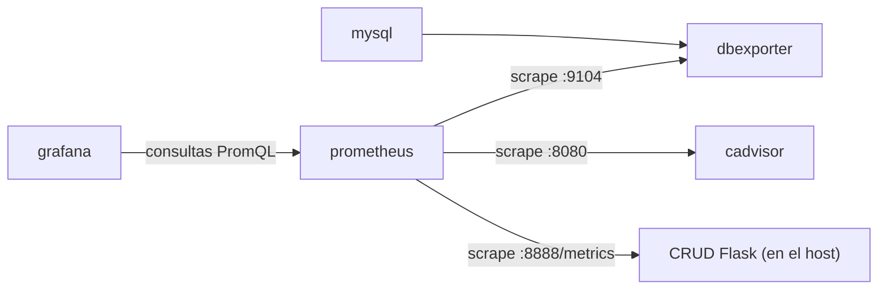

# Explicación del `docker-compose.yml` — Stack de monitoreo con Prometheus y Grafana

**Materia:** Infraestructura de Redes · Etapa 6 (informe de cierre)
**Modalidad:** trabajo individual

---

## Introducción

Este informe explica el `docker-compose.yml` que se utilizó en la práctica de monitoreo en Killercoda. El archivo define cinco servicios que corren en contenedores y comparten una misma red de Docker:

| Servicio | Rol dentro del stack |
| --- | --- |
| `mysql` | Base de datos que se quiere observar. |
| `dbexporter` | Traductor: lee estadísticas internas de MySQL y las publica en un formato que Prometheus entiende. |
| `cadvisor` | Mide el consumo de CPU, memoria, red y disco de cada contenedor. |
| `prometheus` | Recolecta las métricas de todos los anteriores y las guarda como series de tiempo. |
| `grafana` | Consulta a Prometheus y dibuja los datos en paneles y dashboards. |

Además de estos cinco servicios, la práctica incluye una aplicación CRUD hecha en Flask que **no** corre en un contenedor: se ejecuta directamente en la máquina anfitriona (puerto 8888) y expone sus propias métricas en `/metrics`. Esa diferencia tiene consecuencias en la configuración, que se explican en las Partes 2 y 4.

Los archivos de configuración del stack están en la carpeta `/root/monitoreo`: `docker-compose.yml`, `prometheus.yml` y `my.cnf`.

### Estructura general del `docker-compose.yml`

El archivo tiene tres claves en el nivel superior:

```yaml
version: '3'
services:
  # mysql, dbexporter, cadvisor, prometheus, grafana
networks:
  mynetwork:
```

- **`version: '3'`** indica el formato del archivo. Va entre comillas para que YAML lo lea como texto y no como el número 3. En las versiones actuales de Docker Compose este campo es obsoleto: se ignora y solo genera una advertencia.
- **`services:`** contiene la definición de cada contenedor. Cada servicio es una clave con su propio bloque, y todos usan `restart: always`.
- **`networks:`** declara las redes que se crean (en este caso, `mynetwork`).

### Flujo de datos

El stack sigue el modelo *pull* de Prometheus: no es la aplicación la que envía datos, sino Prometheus el que sale a consultarlos cada cierto tiempo.



### Organización del informe

1. **Parte 1:** `mysql` y `dbexporter`.
2. **Parte 2:** `cadvisor` y `prometheus`.
3. **Parte 3:** `grafana` y la red `mynetwork`.
4. **Parte 4:** el archivo `prometheus.yml`, que define qué consulta Prometheus.
5. **Práctica en Killercoda:** evidencia de lo realizado, con capturas.
6. **Conclusión.**

En cada parte se explica qué hace el servicio y cómo se lee la sintaxis YAML que aparece.
