# Explicación del `docker-compose.yml` — Stack de monitoreo con Prometheus y Grafana

**Materia:** Infraestructura de Redes · Etapa 6 (informe de cierre)
**Modalidad:** trabajo individual

---

## Introducción

Este informe explica el `docker-compose.yml` que se utilizó en la práctica de monitoreo en Killercoda. El archivo define cinco servicios que corren en contenedores y comparten una misma red de Docker:

| Servicio | Rol dentro del stack |
| --- | --- |
| `mysql` | Base de datos que se quiere observar. |
| `dbexporter` | Traductor: lee estadísticas internas de MySQL y las publica en un formato que Prometheus entiende. |
| `cadvisor` | Mide el consumo de CPU, memoria, red y disco de cada contenedor. |
| `prometheus` | Recolecta las métricas de todos los anteriores y las guarda como series de tiempo. |
| `grafana` | Consulta a Prometheus y dibuja los datos en paneles y dashboards. |

Además de estos cinco servicios, la práctica incluye una aplicación CRUD hecha en Flask que **no** corre en un contenedor: se ejecuta directamente en la máquina anfitriona (puerto 8888) y expone sus propias métricas en `/metrics`. Esa diferencia tiene consecuencias en la configuración, que se explican en las Partes 2 y 4.

Los archivos de configuración del stack están en la carpeta `/root/monitoreo`: `docker-compose.yml`, `prometheus.yml` y `my.cnf`.

### Estructura general del `docker-compose.yml`

El archivo tiene tres claves en el nivel superior:

```yaml
version: '3'
services:
  # mysql, dbexporter, cadvisor, prometheus, grafana
networks:
  mynetwork:
```

- **`version: '3'`** indica el formato del archivo. Va entre comillas para que YAML lo lea como texto y no como el número 3. En las versiones actuales de Docker Compose este campo es obsoleto: se ignora y solo genera una advertencia.
- **`services:`** contiene la definición de cada contenedor. Cada servicio es una clave con su propio bloque, y todos usan `restart: always`.
- **`networks:`** declara las redes que se crean (en este caso, `mynetwork`).

### Flujo de datos

El stack sigue el modelo *pull* de Prometheus: no es la aplicación la que envía datos, sino Prometheus el que sale a consultarlos cada cierto tiempo.

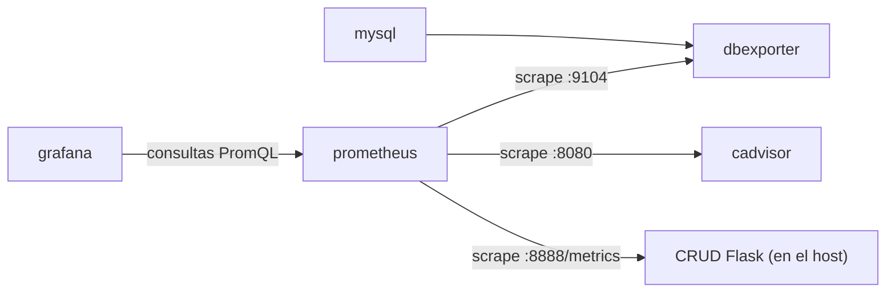

### Organización del informe

1. **Parte 1:** `mysql` y `dbexporter`.
2. **Parte 2:** `cadvisor` y `prometheus`.


---

## Parte 1 — Persistencia de datos: `mysql` y `dbexporter`

### El servicio `mysql`

```yaml
mysql:
  image: mysql:latest
  restart: always
  environment:
    MYSQL_ROOT_PASSWORD: mysecretpassword
  networks:
    - mynetwork
```

| Línea | Qué hace |
| --- | --- |
| `mysql:` | Nombre del servicio. Además de identificarlo dentro del archivo, pasa a ser su nombre de host dentro de la red (ver Parte 3). |
| `image: mysql:latest` | Imagen a partir de la cual se crea el contenedor. La imagen es la plantilla con el programa ya instalado; el contenedor es esa plantilla puesta en marcha. `latest` es una etiqueta que apunta a la versión más reciente publicada, por lo que el resultado puede cambiar con el tiempo. |
| `restart: always` | Docker vuelve a levantar el contenedor si se cae o si se reinicia el servicio de Docker. |
| `environment:` | Bloque de variables de entorno que se le entregan al proceso del contenedor. |
| `MYSQL_ROOT_PASSWORD: ...` | Variable que la imagen de MySQL lee en el primer arranque para fijar la contraseña del usuario `root`. |
| `networks: - mynetwork` | Conecta el contenedor a la red `mynetwork`. |

**¿Por qué la contraseña va por variable de entorno?**
La imagen de MySQL es genérica y la usa cualquier persona. Si la contraseña estuviera escrita dentro de la imagen, habría que construir una imagen distinta para cada entorno. Con una variable de entorno la imagen no cambia y el valor se entrega desde afuera en el momento de crear el contenedor: se cambia editando una línea del compose.

Tiene un límite que conviene tener claro: la contraseña queda escrita en texto plano en el `docker-compose.yml` y puede verse inspeccionando el contenedor. Sirve para un laboratorio, pero en un entorno real se usarían mecanismos pensados para secretos (por ejemplo `secrets` de Docker o un archivo `.env` que no se suba al repositorio).

**Observación sobre la persistencia.** El servicio no declara ningún volumen para los datos de MySQL. Eso significa que la información vive dentro del contenedor y se perdería si el contenedor se elimina. Para conservarla se agregaría una sección `volumes:` que monte un volumen en `/var/lib/mysql`. En este laboratorio no es un problema porque lo que importa es observar el comportamiento de la base, no guardar sus datos.

### El servicio `dbexporter`

```yaml
dbexporter:
  image: prom/mysqld-exporter:latest
  restart: always
  volumes:
    - ./my.cnf:/.my.cnf:ro
  command:
    - --config.my-cnf=/.my.cnf
  depends_on:
    - mysql
  networks:
    - mynetwork
```

MySQL no sabe hablar el formato que Prometheus espera. `mysqld-exporter` resuelve eso: se conecta a MySQL, consulta sus contadores internos (conexiones, consultas, estado del servidor, etc.) y los publica por HTTP en el puerto 9104. Ese es el endpoint que luego aparece como target en Prometheus (`dbexporter:9104`).

| Línea | Qué hace |
| --- | --- |
| `image: prom/mysqld-exporter:latest` | Imagen oficial del exporter de Prometheus para MySQL. |
| `volumes:` | Lista de archivos o carpetas del host que se hacen visibles dentro del contenedor. |
| `./my.cnf:/.my.cnf:ro` | Formato `origen:destino:modo`. Toma el `my.cnf` que está junto al compose (`./` es la carpeta actual) y lo deja disponible en `/.my.cnf` dentro del contenedor. |
| `command:` | Argumentos que se le pasan al programa al iniciar. |
| `--config.my-cnf=/.my.cnf` | Le indica al exporter en qué ruta está el archivo con los datos para conectarse a MySQL. |
| `depends_on: - mysql` | Declara que este servicio necesita de `mysql`. |

**¿Para qué se monta `my.cnf` de solo lectura?**
El `my.cnf` contiene los datos de conexión a MySQL, es decir, información sensible. Montarlo evita meter credenciales dentro de la imagen o repetirlas en el compose. El modo `:ro` (*read only*) hace que el contenedor pueda leer el archivo pero no modificarlo ni borrarlo, aunque el proceso interno tuviera un error o fuera comprometido. El exporter solo necesita leer, así que se le da únicamente ese permiso (principio de mínimo privilegio).

**Relación de dependencia entre `dbexporter` y `mysql`.**
`depends_on: - mysql` hace que Docker Compose inicie primero el contenedor de MySQL y después el del exporter, ya que el exporter no tiene nada que medir si la base no existe. Hay una precisión importante: en esta forma simple, `depends_on` solo controla el **orden de arranque**, no espera a que MySQL esté realmente listo para aceptar conexiones. Si el exporter arranca un instante antes de que MySQL termine de inicializarse, puede fallar al conectarse; en este stack `restart: always` ayuda a que se recupere solo.

### Sintaxis YAML de esta parte

- **Jerarquía por indentación.** La estructura se expresa con espacios (en este archivo, dos por nivel). No se pueden usar tabuladores, y una línea mal indentada cambia el significado o rompe el archivo.
- **Pares `clave: valor`** (mapeos): `image: mysql:latest`, `restart: always`. Después de los dos puntos va un espacio.
- **Listas con guion:** cada elemento empieza con `- `. Son listas `networks`, `volumes`, `command` y `depends_on`.
- **Mapeo dentro de otro mapeo:** `environment:` contiene `MYSQL_ROOT_PASSWORD: ...` como par clave-valor. Compose también acepta `environment` como lista (`- CLAVE=valor`), forma que se ve en Grafana en la Parte 3.
- **Cadenas con dos puntos:** `./my.cnf:/.my.cnf:ro` es un único texto con tres campos separados por `:`.

4. **Parte 3:** `grafana` y la red `mynetwork`.
5. **Parte 4:** el archivo `prometheus.yml`, que define qué consulta Prometheus.
6. **Práctica en Killercoda:** evidencia de lo realizado, con capturas.
7. **Conclusión.**


---

## Parte 2 — Recolección de métricas: `cadvisor` y `prometheus`

### El servicio `cadvisor`

cAdvisor observa a los demás contenedores y mide cuánta CPU, memoria, red y disco consume cada uno. Publica esas métricas por HTTP en el puerto 8080 del contenedor.

```yaml
cadvisor:
  image: gcr.io/cadvisor/cadvisor:v0.47.2
  restart: always
  volumes:
    - /:/rootfs:ro
    - /var/run:/var/run:ro
    - /sys:/sys:ro
    - /var/lib/docker/:/var/lib/docker:ro
    - /dev/disk/:/dev/disk:ro
  networks:
    - mynetwork
```

La imagen usa una versión fija (`v0.47.2`) en lugar de `latest`, y el prefijo `gcr.io/` indica que no se descarga de Docker Hub sino del registro de contenedores de Google.

**¿Por qué monta rutas del host y por qué en solo lectura?**
Un contenedor está aislado: por defecto solo ve su propio sistema de archivos. Pero cAdvisor justamente necesita ver lo que ocurre con *otros* contenedores, y esa información la tiene el sistema anfitrión:

| Ruta del host | Para qué la necesita cAdvisor |
| --- | --- |
| `/` (montada como `/rootfs`) | Ver el sistema de archivos del host y calcular uso de disco. |
| `/var/run` | Contiene el socket de Docker, por el que se consulta qué contenedores existen. |
| `/sys` | Ahí el kernel expone los *cgroups*, que son los contadores de CPU y memoria de cada contenedor. |
| `/var/lib/docker` | Datos y estado de los contenedores. |
| `/dev/disk` | Información de los discos. |

Todas llevan `:ro` porque cAdvisor solo **observa**. Como se le da mucha visibilidad sobre el host, se le quita la posibilidad de escribir: si algo saliera mal, no podría modificar el sistema.

### El servicio `prometheus`

Prometheus es el recolector. Cada pocos segundos visita cada target (el endpoint de un servicio que expone métricas) y guarda lo que encuentra como series de tiempo, que luego se pueden consultar con PromQL. Qué targets visita lo define el archivo `prometheus.yml` (Parte 4).

```yaml
prometheus:
  image: prom/prometheus:latest
  restart: always
  ports:
    - "9090:9090"
  volumes:
    - ./prometheus.yml:/etc/prometheus/prometheus.yml
  extra_hosts:
    - "host.docker.internal:host-gateway"
  networks:
    - mynetwork
```

**¿Qué puerto se publica y por qué?**
`ports` usa el formato `"PUERTO_HOST:PUERTO_CONTENEDOR"`. Con `"9090:9090"`, lo que llegue al puerto 9090 de la máquina anfitriona se redirige al 9090 del contenedor de Prometheus. Se publica porque hay que entrar a su interfaz web desde el navegador para ver los targets y ejecutar consultas. En cambio, cAdvisor no necesita publicar nada: su único cliente es Prometheus, que lo alcanza por la red interna como `cadvisor:8080`. Publicar solo lo imprescindible reduce lo que queda expuesto.

**¿Qué resuelve `extra_hosts` con `host.docker.internal`?**
La aplicación Flask del CRUD corre en el host, fuera de `mynetwork`. Por eso Prometheus no puede encontrarla por nombre de servicio como hace con `cadvisor` o `dbexporter`. `extra_hosts` agrega una entrada al archivo `/etc/hosts` del contenedor: el nombre `host.docker.internal` pasa a apuntar a la dirección del host, y `host-gateway` es el valor especial con el que Docker completa esa dirección automáticamente. Gracias a esto funciona el target `host.docker.internal:8888`. En Linux ese nombre no existe por defecto (en Docker Desktop sí), de ahí que haya que declararlo.

**¿Cómo recibe Prometheus su configuración?**
El volumen `./prometheus.yml:/etc/prometheus/prometheus.yml` toma el archivo que está junto al compose y lo coloca en la ruta donde Prometheus busca su configuración. Así se puede cambiar qué se monitorea editando un archivo del host, sin modificar la imagen. A diferencia de los volúmenes anteriores, este no lleva `:ro`.

### Sintaxis YAML de esta parte

- **Cadenas entre comillas:** `"9090:9090"` y `"host.docker.internal:host-gateway"` van entre comillas para que YAML las tome siempre como texto. Con los puertos es una práctica recomendada por Docker, porque un valor con formato `NN:NN` donde el segundo número es menor que 60 (por ejemplo `22:22`) puede interpretarse como un número en base 60 y no como un mapeo de puertos.
- **Listas de cadenas** con patrón `origen:destino` en `volumes`, `ports` y `extra_hosts`.
- **Rutas absolutas y relativas:** las de cAdvisor (`/sys`, `/var/run`) son absolutas del host; `./prometheus.yml` es relativa a la carpeta del compose.
- **Etiqueta de imagen:** `v0.47.2` fija una versión concreta, mientras que `latest` puede cambiar.
- **Ruta completa de imagen:** `gcr.io/cadvisor/cadvisor:v0.47.2` sigue el patrón `registro/organización/imagen:etiqueta`.

- 

---

## Parte 3 — Visualización y topología: `grafana` y la red `mynetwork`

### El servicio `grafana`

```yaml
grafana:
  # Versión fijada a propósito: la UI de Grafana cambia entre releases y la guía
  # (Paso 3) describe pantallas concretas. Con :latest la navegación descrita se
  # desincroniza sola. 13.2.2 es la versión contra la que está escrito el Paso 3.
  image: grafana/grafana:13.2.2
  restart: always
  ports:
    - "3000:3000"
  environment:
    - GF_SECURITY_ADMIN_PASSWORD=admin
  depends_on:
    - prometheus
  networks:
    - mynetwork
```

| Línea | Qué hace |
| --- | --- |
| `image: grafana/grafana:13.2.2` | Imagen oficial de Grafana con la versión fija. El comentario del propio archivo explica el motivo: la interfaz de Grafana cambia entre versiones y la guía de la práctica describe pantallas concretas, por lo que con `latest` esas instrucciones podrían dejar de coincidir con lo que se ve. |
| `ports: - "3000:3000"` | Publica la interfaz web de Grafana en el puerto 3000 del host, para abrirla desde el navegador. |
| `environment: - GF_SECURITY_ADMIN_PASSWORD=admin` | Fija la contraseña inicial del usuario `admin`. Aquí `environment` está escrito como lista (`CLAVE=valor`), forma equivalente a la de `mysql`. |
| `depends_on: - prometheus` | Grafana se inicia después de Prometheus. |
| `networks: - mynetwork` | Lo conecta a la red común. |

**¿Por qué Grafana depende de Prometheus?**
Grafana no recolecta ni guarda métricas: es solo la capa de visualización. Cada gráfico que muestra es el resultado de una consulta PromQL enviada a Prometheus, que es la fuente de datos. Sin Prometheus, Grafana no tiene qué dibujar.

Con `depends_on` esa relación queda expresada en el archivo y Docker arranca Prometheus primero. Como en el caso de `dbexporter`, esto fija el orden de arranque pero no garantiza que Prometheus ya esté respondiendo. Grafana puede iniciar sin él; la dependencia es lógica: sin Prometheus no hay datos que mostrar.

### La red `mynetwork`

Al final del compose se declara la red a nivel raíz, y cada servicio se une a ella con su propia sección `networks`:

```yaml
networks:
  mynetwork:
```

Compose crea esa red (por defecto de tipo *bridge*) y conecta a ella los cinco servicios. Dentro de una red definida por el usuario, Docker incluye un **servidor DNS interno**: cada contenedor se registra con el nombre de su servicio, y cualquier otro contenedor de la misma red puede usar ese nombre en lugar de una dirección IP.

Eso es lo que hace posible que el stack funcione sin conocer ninguna IP:

| Quién consulta | A quién | Dirección que se usa |
| --- | --- | --- |
| Grafana | Prometheus | `http://prometheus:9090` |
| Prometheus | cAdvisor | `cadvisor:8080` |
| Prometheus | dbexporter | `dbexporter:9104` |
| dbexporter | MySQL | el servidor indicado en `my.cnf`; al estar ambos en la red, MySQL se alcanza por el nombre `mysql` |
| Prometheus | Aplicación Flask (fuera de la red) | `host.docker.internal:8888` |

Las IP de los contenedores cambian cada vez que se recrean, pero los nombres de servicio no. Además, la comunicación entre servicios dentro de la red usa los puertos internos del contenedor y **no requiere publicarlos** hacia el host. Por eso solo Prometheus y Grafana tienen `ports`: son los únicos a los que una persona entra desde el navegador.

Desde el navegador del host se usa `localhost:3000`, pero desde Grafana hacia Prometheus se usa el nombre `prometheus`. Cada lado tiene su forma de nombrar según desde dónde se mira.

### Sintaxis YAML de esta parte

- **Comentarios:** las líneas que empiezan con `#` son ignoradas por YAML. El bloque de Grafana tiene un comentario de tres líneas que documenta por qué se fijó la versión.
- **`environment` como lista:** `- GF_SECURITY_ADMIN_PASSWORD=admin` es una lista de textos con formato `CLAVE=valor`. En `mysql` se vio la forma de mapeo (`CLAVE: valor`). Compose acepta las dos.
- **Declaración y uso de la red:** `networks:` aparece en dos lugares con distinto significado. A nivel raíz *declara* qué redes existen; dentro de un servicio *indica a cuáles se une* ese servicio.
- **Clave con valor vacío:** `mynetwork:` sin nada a continuación es válido en YAML y significa que la red se crea con la configuración por defecto.


En cada parte se explica qué hace el servicio y cómo se lee la sintaxis YAML que aparece.


---

## Parte 4 — El archivo `prometheus.yml`

Este archivo no forma parte del `docker-compose.yml`: es la configuración de Prometheus, y se le entrega al contenedor mediante un volumen (ver Parte 2). Define cada cuánto consultar y a quién.

```yaml
global:
  scrape_interval: 5s

scrape_configs:
  - job_name: 'prometheus'
    static_configs:
      - targets: ['localhost:9090']

  - job_name: 'cadvisor'
    static_configs:
      - targets: ['cadvisor:8080']

  - job_name: 'mysql'
    static_configs:
      - targets: ['dbexporter:9104']

  - job_name: 'crud-app'
    static_configs:
      - targets: ['host.docker.internal:8888']
```

- **`global.scrape_interval: 5s`**: Prometheus consulta cada target cada 5 segundos. En la pantalla de Targets se ve que el "last scrape" nunca supera unos pocos segundos.
- **`scrape_configs`**: lista de *jobs*. Cada job agrupa uno o más targets del mismo tipo.
- **`job_name`**: nombre del grupo. Prometheus lo agrega como etiqueta `job` a cada métrica, por eso en la consulta `up` aparecen `job="mysql"`, `job="cadvisor"`, etc.
- **`static_configs` / `targets`**: lista fija de direcciones `host:puerto` a consultar. Por defecto Prometheus pide la ruta `/metrics`. La dirección completa también queda como etiqueta `instance`.

Hay un detalle en los nombres elegidos. Prometheus se consulta a sí mismo como `localhost:9090` porque, dentro de su propio contenedor, `localhost` es él mismo. Los servicios que están en la red (`cadvisor` y `dbexporter`) se nombran por su nombre de servicio, gracias a `mynetwork`. La aplicación Flask, que está fuera de la red, se nombra con `host.docker.internal` (ver `extra_hosts` en la Parte 2). Es decir, el archivo usa tres formas distintas de direccionar según dónde viva cada target.

Un detalle sobre cómo llega este archivo al contenedor: el volumen en el compose no lleva `:ro`, aunque Prometheus solo necesita leerlo. Agregarlo sería coherente con el criterio de mínimo privilegio que se aplica en los otros volúmenes, y el laboratorio funcionaría igual.


---

## Práctica en Killercoda

Evidencia de la práctica de monitoreo realizada en Killercoda, en el orden en que se hizo. Como cada entorno dura una hora y luego se destruye, la práctica se hizo en dos sesiones: en la primera se recorrieron los pasos de Prometheus y la conexión con Grafana (secciones 1 a 6), y en la segunda se volvió a conectar la fuente de datos, se armó el dashboard y se ejecutó la prueba de carga (secciones 7 a 9). Por eso el identificador del contenedor de MySQL que aparece en la consulta de CPU de la sección 5 corresponde a la primera sesión y cambia en cada entorno nuevo.

### Conceptos previos: métricas y logs

Un **log** es un registro de eventos: una línea por cada petición o consulta, con todo el detalle de lo ocurrido. Sirve para investigar un momento puntual, pero hay que ir a buscarlo, filtrarlo y leerlo, como se hacía con `grep` y `awk` en la práctica anterior.

Una **métrica** es un número que cambia en el tiempo: peticiones por segundo, conexiones abiertas, CPU utilizada. No cuenta la historia de cada petición, pero permite ver tendencias y picos de un vistazo y disparar alertas automáticas. Los dos enfoques se complementan: las métricas sirven para detectar que algo pasa, y los logs para investigar el detalle después.

En este stack hay tres fuentes de métricas: la aplicación Flask (que las expone directamente en `/metrics`), MySQL (a través de `dbexporter`) y los contenedores (a través de cAdvisor). Prometheus las junta a todas con el mecanismo de *scrape* descrito en la Parte 4.

### 1. Entorno listo

El entorno levanta los servicios descritos en el informe: MySQL en la red interna, `dbexporter`, cAdvisor, Prometheus en el puerto 9090, Grafana en el 3000 y la aplicación CRUD Flask en el 8888 con sus métricas en `/metrics`.

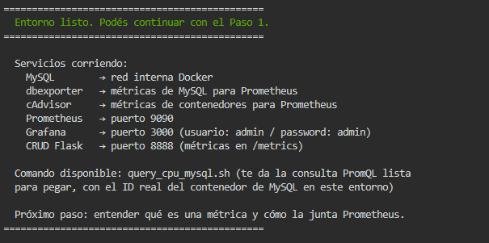

### 2. Métricas de la aplicación

Con `curl -s http://127.0.0.1:8888/metrics | head -20` se ve el formato de texto que expone la aplicación. Cada métrica va precedida por una línea `# HELP` (descripción) y una `# TYPE` (tipo: `counter`, `gauge`, etc.). Prometheus lee exactamente este formato.

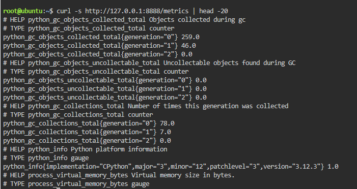

### 3. Targets en Prometheus

En *Status → Target health* se ven los cuatro jobs definidos en `prometheus.yml` (`cadvisor`, `crud-app`, `mysql` y `prometheus`), todos en estado **UP**. Se observa que cada uno se consulta con la dirección que corresponde: nombres de servicio para los que están en la red, y `host.docker.internal:8888` para la aplicación del host.

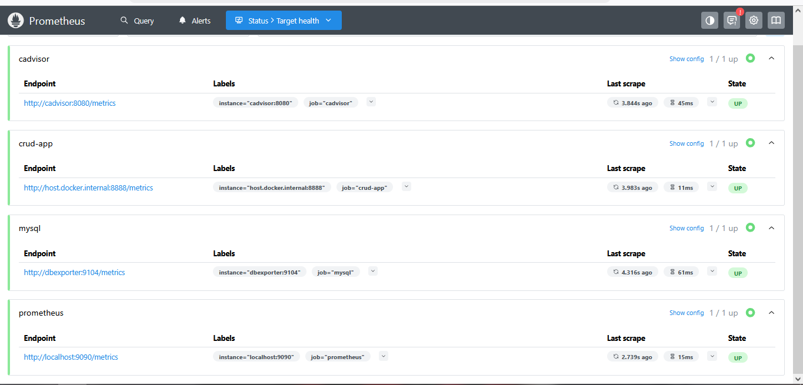

### 4. La consulta `up`

La consulta PromQL `up` devuelve una serie por target: `1` si la última consulta tuvo éxito y `0` si falló. Aquí devuelve cuatro series con valor 1, coherente con la pantalla anterior.

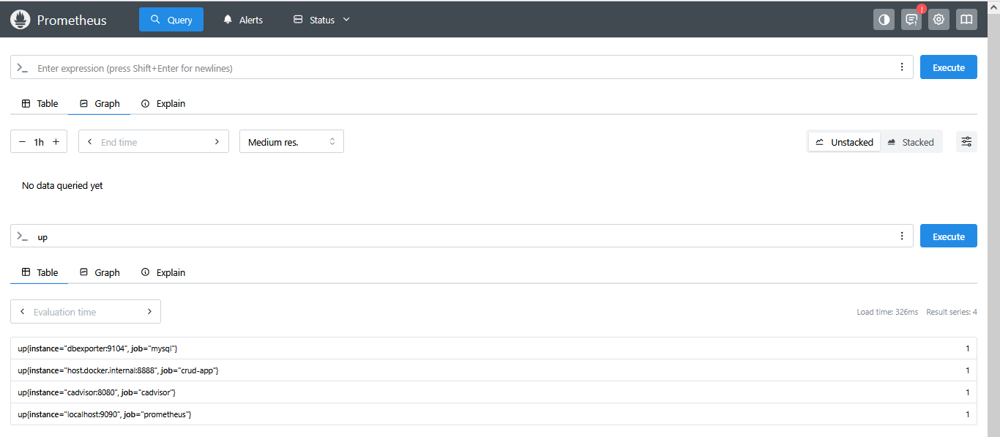

### 5. Métricas de MySQL y de contenedores

Primero se consultó `mysql_global_status_threads_connected`, que muestra cuántas conexiones tiene abiertas MySQL en cada momento (es un *gauge*, un valor que sube y baja). El gráfico muestra un valor constante de 2.

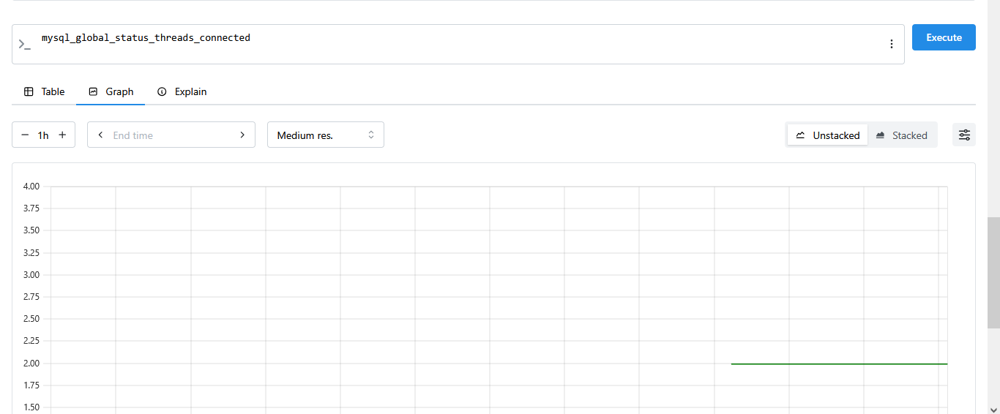

Después se ejecutó una consulta sobre las métricas de cAdvisor para ver la CPU del contenedor de MySQL:

```promql
rate(container_cpu_usage_seconds_total{id=~".*cb51958903ff.*"}[1m])
```

`container_cpu_usage_seconds_total` es un contador acumulado (siempre crece). La función `rate(...[1m])` lo convierte en una velocidad: cuántos segundos de CPU por segundo se consumieron, promediado en la última ventana de un minuto. El filtro `id=~".*cb51958903ff.*"` usa una expresión regular para quedarse solo con el contenedor cuyo identificador contiene ese fragmento, que corresponde a MySQL en este entorno. En el gráfico se observa un pico al comienzo y luego un consumo bajo y estable, cercano a 0,01.

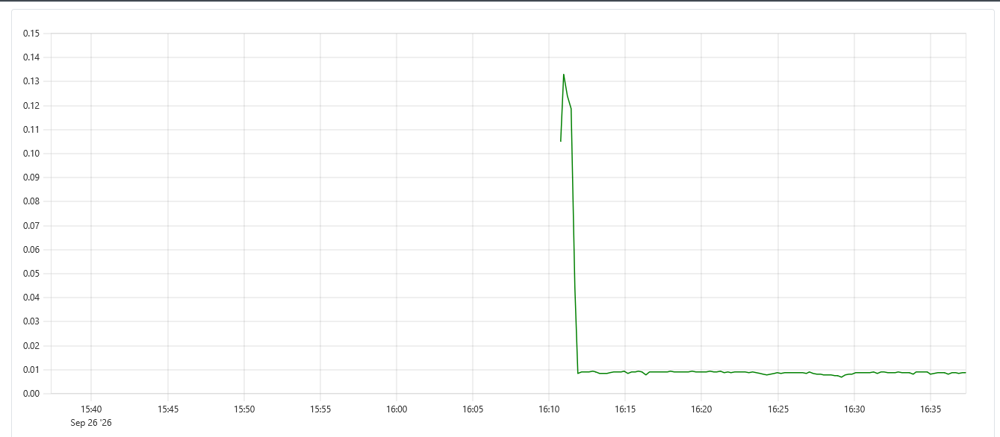

### 6. Conexión de Prometheus con Grafana

En Grafana se agregó Prometheus como fuente de datos (*Connections → Data sources → Add data source*). Como URL del servidor se usó el nombre del servicio, `http://prometheus:9090`, y no `localhost`: Grafana y Prometheus corren en contenedores distintos y se alcanzan por el DNS interno de la red `mynetwork` (ver Parte 3). Al presionar *Save & test*, Grafana confirmó "Successfully queried the Prometheus API".

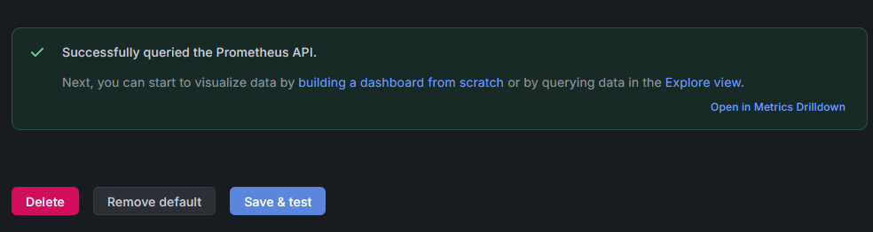

### 7. Primer panel: Requests por segundo

En un dashboard nuevo (llamado `DATA`) se creó un panel con la fuente `prometheus`, el título "Requests por segundo" y la consulta:

```promql
rate(flask_http_request_duration_seconds_count[1m])
```

La métrica `flask_http_request_duration_seconds_count` cuenta cuántos pedidos HTTP recibió la aplicación; con `rate` se obtiene el promedio de pedidos por segundo en la última ventana de un minuto. La leyenda muestra las etiquetas con las que Prometheus identifica la serie: `job="crud-app"`, `instance="host.docker.internal:8888"`, `method="GET"`, `path="/"` y `status="200"`. Antes de generar carga el valor es 0, porque la aplicación casi no recibe tráfico.

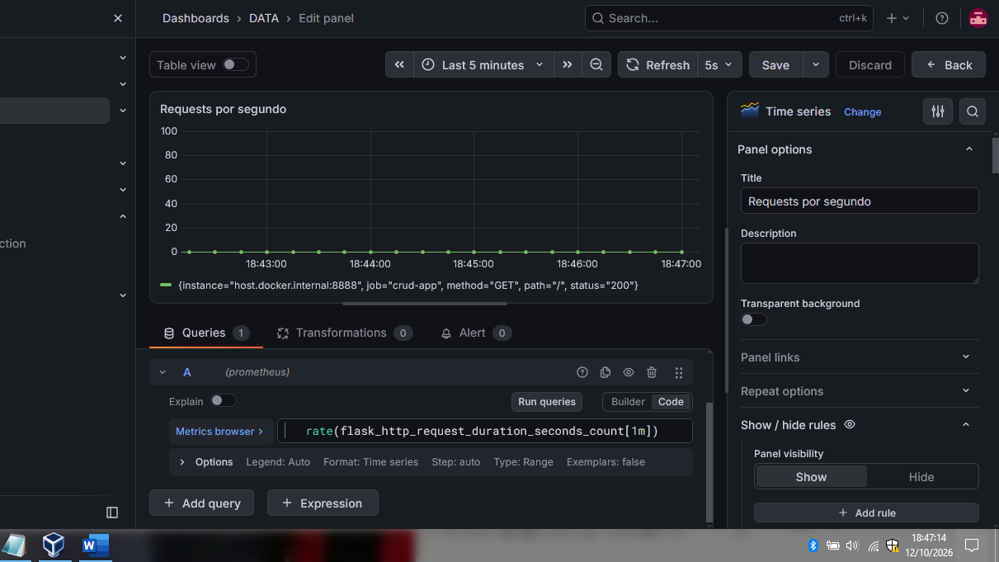

### 8. Segundo panel: Conexiones MySQL

Se agregó un segundo panel con la consulta `mysql_global_status_threads_connected`, que muestra cuántas conexiones tiene abiertas MySQL. En reposo el valor es 2. La serie viene del job `mysql` y su instancia es `dbexporter:9104`, lo que confirma que los datos pasan por el exporter y no directamente por MySQL.

El dashboard se configuró con un rango de *Last 5 minutes* y un refresco automático de 5 segundos, igual al intervalo de consulta de Prometheus.

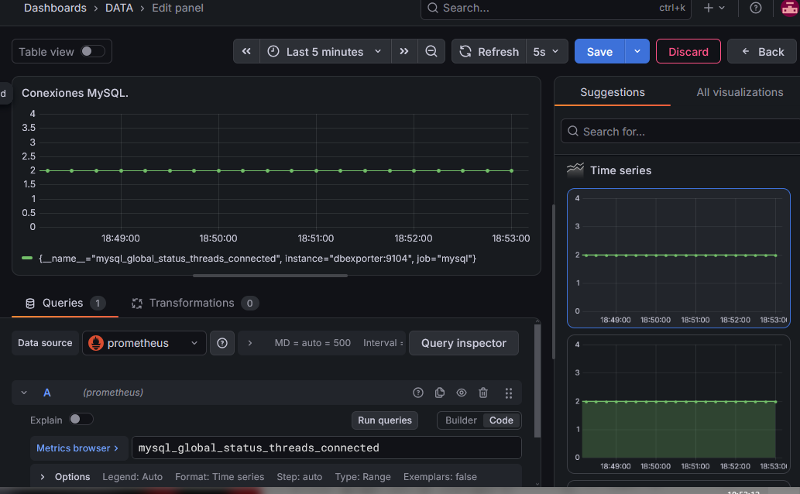

### 9. Prueba de carga en vivo

Con los dos paneles a la vista se generó tráfico contra la aplicación desde la terminal:

```bash
seq 1 2000 | xargs -P 50 -I{} curl -s -o /dev/null http://127.0.0.1:8888/
```

El comando se lee de izquierda a derecha: `seq 1 2000` genera los números del 1 al 2000, uno por línea; `xargs -P 50 -I{}` ejecuta un comando por cada línea, con hasta 50 en paralelo; y cada comando es un `curl` silencioso (`-s`) que descarta la respuesta (`-o /dev/null`) y pide la página principal. En total son 2000 peticiones con 50 simultáneas.

En las capturas se observa el efecto sobre ambos paneles mientras la carga corría. Al comienzo, el panel de requests sale de 0 y las conexiones a MySQL saltan de 2 a casi 50:

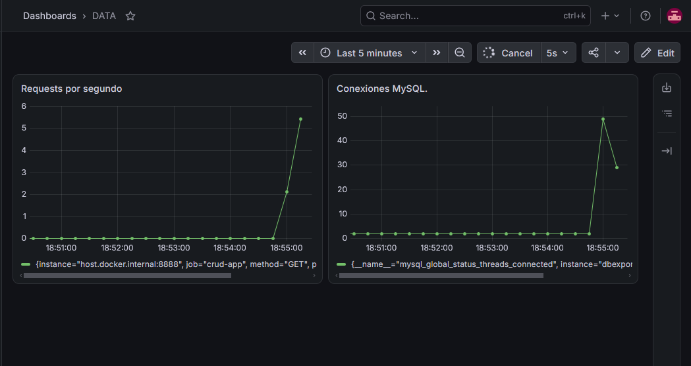

Con la carga en curso, las peticiones por segundo siguen subiendo hasta alrededor de 13,5, y las conexiones a MySQL oscilan entre aproximadamente 20 y 50:

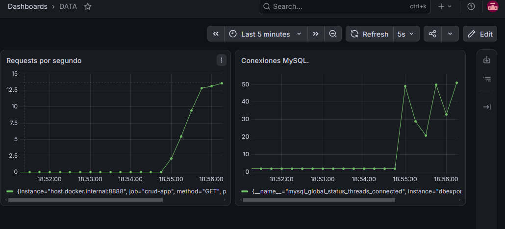

Al terminar el comando el tráfico se detiene y ambos paneles vuelven al reposo. Esta última captura muestra la curva completa de la prueba: valores planos antes de empezar, una subida, una meseta de unas 13 peticiones por segundo durante poco más de dos minutos, y una bajada hasta 0. Las conexiones a MySQL regresan a 2, el mismo valor que tenían antes de la carga:

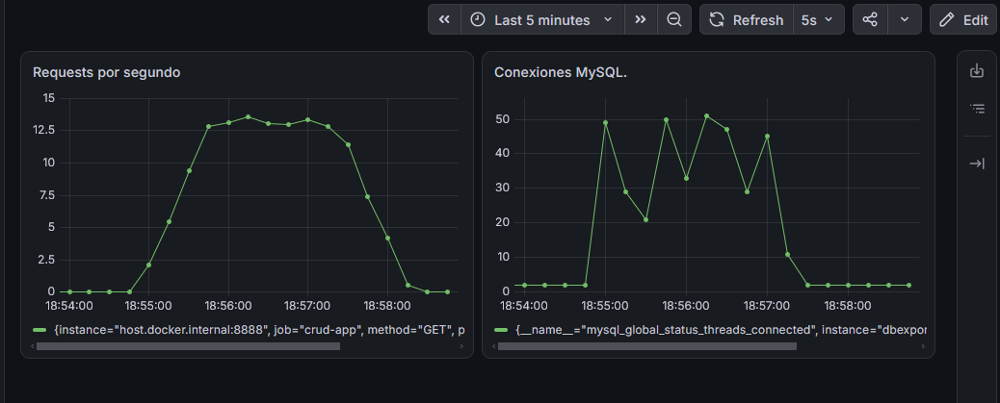

Hay tres cosas para interpretar. La subida de requests es gradual y no instantánea porque `rate(...[1m])` promedia el último minuto, así que en los primeros segundos el valor graficado queda por debajo del tráfico real, y por la misma razón la bajada también es en rampa. Las conexiones, en cambio, cayeron a 2 en un par de muestras, porque `mysql_global_status_threads_connected` es un *gauge*: muestra el valor del instante y no un promedio. Y las conexiones cercanas a 50 son coherentes con las 50 peticiones simultáneas: cada petición a `/` dispara una consulta a la base, de modo que el número de conexiones acompaña al tráfico.

**Comparación con la práctica de logs.** Con logs había que esperar a que terminara la carga, buscar el archivo, filtrarlo y contarlo con `grep` y `awk` para recién entonces notar el pico. Con Prometheus y Grafana el pico se vio mientras ocurría, sin abrir ningún archivo. En un entorno real se usan los dos enfoques: métricas para detectar y alertar en el momento, y logs para investigar el detalle después.

**Sintaxis YAML:**

- **Lista de mapeos:** cada `- job_name: ...` abre un elemento de la lista `scrape_configs`, y el elemento es un conjunto de claves (`job_name`, `static_configs`).
- **Listas anidadas:** `static_configs` es una lista cuyo elemento contiene `targets`, que es a su vez otra lista.
- **Dos estilos de lista:** `['cadvisor:8080']` es la forma *en línea* (entre corchetes, separada por comas), equivalente a escribir `- cadvisor:8080` en una línea aparte, que es el estilo en bloque usado en el compose.
- **Comillas simples:** `'prometheus'` y `'localhost:9090'` marcan el valor como texto. En el nombre del job son opcionales, pero en las direcciones con `:` conviene usarlas.


---

## Conclusión

Un stack de monitoreo es una cadena de piezas pequeñas y cada una hace una sola tarea: el exporter traduce, cAdvisor mide contenedores, Prometheus recolecta y guarda, y Grafana muestra. El `docker-compose.yml` describe cómo se conectan, y se puede leer casi como un diagrama.

Varias decisiones del archivo responden al mismo criterio de **dar solo lo necesario**: los volúmenes de cAdvisor y de `my.cnf` se montan en solo lectura (`:ro`) porque esos servicios solo observan o leen; solo Prometheus y Grafana publican puertos, porque son los únicos a los que se entra desde afuera; y la comunicación interna usa nombres de servicio gracias al DNS de la red `mynetwork`, sin depender de direcciones IP que cambian. El caso de la aplicación Flask, que corre en el host, muestra qué pasa cuando algo queda fuera de esa red y por qué hace falta `extra_hosts`.

Al analizarlo también aparecieron límites del laboratorio que en un entorno real habría que resolver: las contraseñas están en texto plano en el compose, MySQL no guarda sus datos en un volumen, varias imágenes usan `latest`, el volumen de `prometheus.yml` no es de solo lectura aunque Prometheus solo lo lee, y `depends_on` ordena el arranque pero no espera a que un servicio esté realmente disponible (para eso existen los *healthchecks*).

La práctica también dejó clara la diferencia entre métricas y logs: durante la prueba de carga, el aumento de peticiones y de conexiones a MySQL, y también su regreso al reposo, se vieron en el dashboard mientras ocurrían, sin buscar ni filtrar ningún archivo, algo que con logs solo se podía descubrir una vez terminada la carga.

En cuanto a la sintaxis YAML, el mismo archivo mostró sus piezas básicas: la jerarquía por indentación, los pares clave-valor, las listas con guion, los comentarios con `#`, las cadenas con comillas cuando contienen `:`, y dos formas equivalentes de escribir algunas estructuras (`environment` como mapeo o como lista; listas en bloque o en línea). Con eso es posible leer cualquier compose del mismo tipo y entender qué hace cada línea.
