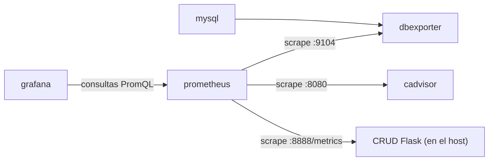

# Explicación del `docker-compose.yml` — Stack de monitoreo con Prometheus y Grafana

**Materia:** Infraestructura de Redes · Etapa 6 (informe de cierre)
**Modalidad:** trabajo individual

---

## Introducción

Este informe explica el `docker-compose.yml` que se utilizó en la práctica de monitoreo en Killercoda. El archivo define cinco servicios que corren en contenedores y comparten una misma red de Docker:

| Servicio | Rol dentro del stack |
| --- | --- |
| `mysql` | Base de datos que se quiere observar. |
| `dbexporter` | Traductor: lee estadísticas internas de MySQL y las publica en un formato que Prometheus entiende. |
| `cadvisor` | Mide el consumo de CPU, memoria, red y disco de cada contenedor. |
| `prometheus` | Recolecta las métricas de todos los anteriores y las guarda como series de tiempo. |
| `grafana` | Consulta a Prometheus y dibuja los datos en paneles y dashboards. |

Además de estos cinco servicios, la práctica incluye una aplicación CRUD hecha en Flask que **no** corre en un contenedor: se ejecuta directamente en la máquina anfitriona (puerto 8888) y expone sus propias métricas en `/metrics`. Esa diferencia tiene consecuencias en la configuración, que se explican en las Partes 2 y 4.

Los archivos de configuración del stack están en la carpeta `/root/monitoreo`: `docker-compose.yml`, `prometheus.yml` y `my.cnf`.

### Estructura general del `docker-compose.yml`

El archivo tiene tres claves en el nivel superior:

```yaml
version: '3'
services:
  # mysql, dbexporter, cadvisor, prometheus, grafana
networks:
  mynetwork:
```

- **`version: '3'`** indica el formato del archivo. Va entre comillas para que YAML lo lea como texto y no como el número 3. En las versiones actuales de Docker Compose este campo es obsoleto: se ignora y solo genera una advertencia.
- **`services:`** contiene la definición de cada contenedor. Cada servicio es una clave con su propio bloque, y todos usan `restart: always`.
- **`networks:`** declara las redes que se crean (en este caso, `mynetwork`).

### Flujo de datos

El stack sigue el modelo *pull* de Prometheus: no es la aplicación la que envía datos, sino Prometheus el que sale a consultarlos cada cierto tiempo.



### Organización del informe

1. **Parte 1:** `mysql` y `dbexporter`.
2. **Parte 2:** `cadvisor` y `prometheus`.


---

## Parte 1 — Persistencia de datos: `mysql` y `dbexporter`

### El servicio `mysql`

```yaml
mysql:
  image: mysql:latest
  restart: always
  environment:
    MYSQL_ROOT_PASSWORD: mysecretpassword
  networks:
    - mynetwork
```

| Línea | Qué hace |
| --- | --- |
| `mysql:` | Nombre del servicio. Además de identificarlo dentro del archivo, pasa a ser su nombre de host dentro de la red (ver Parte 3). |
| `image: mysql:latest` | Imagen a partir de la cual se crea el contenedor. La imagen es la plantilla con el programa ya instalado; el contenedor es esa plantilla puesta en marcha. `latest` es una etiqueta que apunta a la versión más reciente publicada, por lo que el resultado puede cambiar con el tiempo. |
| `restart: always` | Docker vuelve a levantar el contenedor si se cae o si se reinicia el servicio de Docker. |
| `environment:` | Bloque de variables de entorno que se le entregan al proceso del contenedor. |
| `MYSQL_ROOT_PASSWORD: ...` | Variable que la imagen de MySQL lee en el primer arranque para fijar la contraseña del usuario `root`. |
| `networks: - mynetwork` | Conecta el contenedor a la red `mynetwork`. |

**¿Por qué la contraseña va por variable de entorno?**
La imagen de MySQL es genérica y la usa cualquier persona. Si la contraseña estuviera escrita dentro de la imagen, habría que construir una imagen distinta para cada entorno. Con una variable de entorno la imagen no cambia y el valor se entrega desde afuera en el momento de crear el contenedor: se cambia editando una línea del compose.

Tiene un límite que conviene tener claro: la contraseña queda escrita en texto plano en el `docker-compose.yml` y puede verse inspeccionando el contenedor. Sirve para un laboratorio, pero en un entorno real se usarían mecanismos pensados para secretos (por ejemplo `secrets` de Docker o un archivo `.env` que no se suba al repositorio).

**Observación sobre la persistencia.** El servicio no declara ningún volumen para los datos de MySQL. Eso significa que la información vive dentro del contenedor y se perdería si el contenedor se elimina. Para conservarla se agregaría una sección `volumes:` que monte un volumen en `/var/lib/mysql`. En este laboratorio no es un problema porque lo que importa es observar el comportamiento de la base, no guardar sus datos.

### El servicio `dbexporter`

```yaml
dbexporter:
  image: prom/mysqld-exporter:latest
  restart: always
  volumes:
    - ./my.cnf:/.my.cnf:ro
  command:
    - --config.my-cnf=/.my.cnf
  depends_on:
    - mysql
  networks:
    - mynetwork
```

MySQL no sabe hablar el formato que Prometheus espera. `mysqld-exporter` resuelve eso: se conecta a MySQL, consulta sus contadores internos (conexiones, consultas, estado del servidor, etc.) y los publica por HTTP en el puerto 9104. Ese es el endpoint que luego aparece como target en Prometheus (`dbexporter:9104`).

| Línea | Qué hace |
| --- | --- |
| `image: prom/mysqld-exporter:latest` | Imagen oficial del exporter de Prometheus para MySQL. |
| `volumes:` | Lista de archivos o carpetas del host que se hacen visibles dentro del contenedor. |
| `./my.cnf:/.my.cnf:ro` | Formato `origen:destino:modo`. Toma el `my.cnf` que está junto al compose (`./` es la carpeta actual) y lo deja disponible en `/.my.cnf` dentro del contenedor. |
| `command:` | Argumentos que se le pasan al programa al iniciar. |
| `--config.my-cnf=/.my.cnf` | Le indica al exporter en qué ruta está el archivo con los datos para conectarse a MySQL. |
| `depends_on: - mysql` | Declara que este servicio necesita de `mysql`. |

**¿Para qué se monta `my.cnf` de solo lectura?**
El `my.cnf` contiene los datos de conexión a MySQL, es decir, información sensible. Montarlo evita meter credenciales dentro de la imagen o repetirlas en el compose. El modo `:ro` (*read only*) hace que el contenedor pueda leer el archivo pero no modificarlo ni borrarlo, aunque el proceso interno tuviera un error o fuera comprometido. El exporter solo necesita leer, así que se le da únicamente ese permiso (principio de mínimo privilegio).

**Relación de dependencia entre `dbexporter` y `mysql`.**
`depends_on: - mysql` hace que Docker Compose inicie primero el contenedor de MySQL y después el del exporter, ya que el exporter no tiene nada que medir si la base no existe. Hay una precisión importante: en esta forma simple, `depends_on` solo controla el **orden de arranque**, no espera a que MySQL esté realmente listo para aceptar conexiones. Si el exporter arranca un instante antes de que MySQL termine de inicializarse, puede fallar al conectarse; en este stack `restart: always` ayuda a que se recupere solo.

### Sintaxis YAML de esta parte

- **Jerarquía por indentación.** La estructura se expresa con espacios (en este archivo, dos por nivel). No se pueden usar tabuladores, y una línea mal indentada cambia el significado o rompe el archivo.
- **Pares `clave: valor`** (mapeos): `image: mysql:latest`, `restart: always`. Después de los dos puntos va un espacio.
- **Listas con guion:** cada elemento empieza con `- `. Son listas `networks`, `volumes`, `command` y `depends_on`.
- **Mapeo dentro de otro mapeo:** `environment:` contiene `MYSQL_ROOT_PASSWORD: ...` como par clave-valor. Compose también acepta `environment` como lista (`- CLAVE=valor`), forma que se ve en Grafana en la Parte 3.
- **Cadenas con dos puntos:** `./my.cnf:/.my.cnf:ro` es un único texto con tres campos separados por `:`.

4. **Parte 3:** `grafana` y la red `mynetwork`.
5. **Parte 4:** el archivo `prometheus.yml`, que define qué consulta Prometheus.
6. **Práctica en Killercoda:** evidencia de lo realizado, con capturas.
7. **Conclusión.**

En cada parte se explica qué hace el servicio y cómo se lee la sintaxis YAML que aparece.
